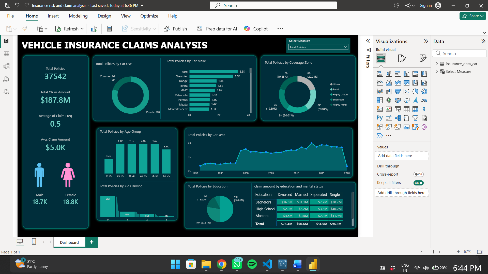

🚗 Vehicle Insurance Risk & Claim Analysis

An Interactive Business Intelligence Dashboard | Microsoft Power BI

  <strong>Transforming Insurance Data into Actionable Business Insights</strong>

⸻

📌 Project Overview

The Vehicle Insurance Risk & Claim Analysis project is an interactive business intelligence solution developed using Microsoft Power BI to explore vehicle insurance policies, customer demographics, vehicle characteristics, and insurance claim patterns.

The dashboard consolidates key performance indicators (KPIs) and interactive visualizations into a single analytical view, enabling users to explore policy distribution, compare customer segments, and understand claim amount trends across different categories.

🎯 Business Objectives

* Analyze the distribution of insurance policies across vehicle and customer segments.
* Monitor key insurance metrics, including total policies and claim amounts.
* Explore policy distribution by car usage, manufacturer, age group, and coverage zone.
* Examine claim amount patterns across education and marital status categories.
* Support data-driven exploration of insurance portfolio performance.

📊 Key Performance Indicators

KPI	Dashboard Value
Total Policies	37,542
Total Claim Amount	$187.8M
Average Claim Frequency	0.5
Average Claim Amount	$5.0K

Values are based on the dashboard’s displayed state and may change when filters are applied.

📈 Dashboard Features

1. Policy Portfolio Analysis

* Policy distribution by private and commercial car usage.
* Comparison of policy counts across car manufacturers.
* Policy distribution across customer age groups.

2. Vehicle & Coverage Analysis

* Policy trends by vehicle year.
* Coverage zone distribution across categories.
* Analysis of policies by the number of kids driving.

3. Customer & Claim Analysis

* Claim amount comparison by education level.
* Claim amount analysis by marital status.
* Exploration of customer demographics alongside insurance metrics.

4. Interactive Data Exploration

* KPI cards for high-level performance monitoring.
* Multiple chart types for comparative analysis.
* Category-level breakdowns to support exploratory analysis.

🛠️ Tools & Technologies

* Microsoft Power BI — Dashboard development and reporting
* Power Query — Data preparation and transformation, where implemented
* DAX — KPI calculations and measures, where implemented
* Data Visualization — Interactive charts and business reporting
* Business Intelligence — Performance monitoring and analytical exploration

🔍 Analytical Approach

1. Data Familiarization: Understand the insurance dataset and available attributes.
2. Data Preparation: Review data quality, column types, and consistency.
3. Metric Analysis: Examine policy counts, claim amounts, and claim frequency.
4. Exploratory Analysis: Compare metrics across customer, vehicle, and coverage categories.
5. Dashboard Development: Organize KPIs and visualizations into an interactive report.
6. Business Interpretation: Use observed patterns to identify areas for further investigation.

💡 Business Value

This dashboard provides a consolidated view of insurance portfolio metrics and claim patterns. It can help business users:

* Compare policy distribution across vehicle and customer categories.
* Identify segments that merit deeper claims investigation.
* Monitor insurance metrics in a visual reporting environment.
* Explore potential relationships between customer characteristics and claim amounts.

Note: Observed patterns do not, by themselves, establish causation or prove insurance risk. Further validation would be required before making underwriting or pricing decisions.

🖥️ Dashboard Preview

📂 Repository Structure

Vehicle-Insurance-Risk-and-Claim-Analysis/
│
├── Insurance risk and claim analysis.pbix
├── Screenshots/
│   └── dashboard-overview.png
└── README.md

The Screenshots folder and image above are planned additions; update this structure after uploading them.

🚀 How to Use

1. Open this repository on GitHub.
2. Download the .pbix Power BI report file.
3. Open the file using Microsoft Power BI Desktop.
4. If prompted, configure the required data source and refresh the data.
5. Explore the dashboard using its available filters and visualizations.

👨‍💻 Author

Ashhad Khan

* GitHub: Ashhadkhan7002
* LinkedIn: www.linkedin.com/in/ashhad-rehman-khan-569750299.

⸻

📌 Project Disclaimer

This project is intended for educational and portfolio demonstration purposes. Business conclusions should be validated against the underlying dataset, metric definitions, and relevant business context.

If the dataset contains third-party or sensitive information, ensure you have permission to publish it before sharing it publicly.
